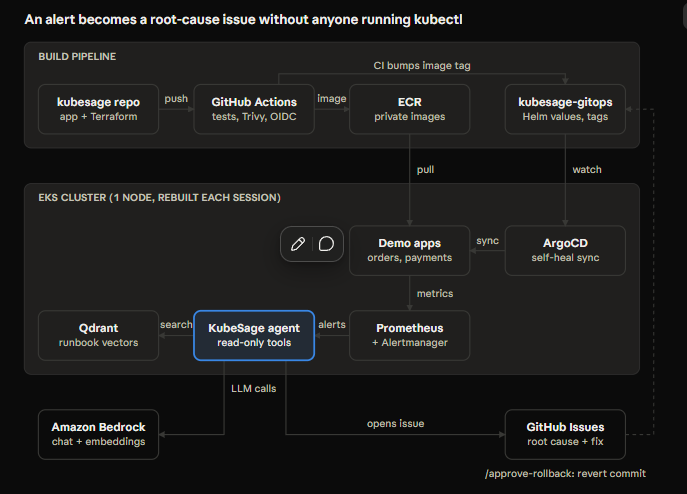

# KubeSage — AI Incident Copilot on AWS

When a Prometheus alert fires, KubeSage investigates the failing pod by itself and opens a GitHub issue with the root cause, the evidence and a suggested fix. A human approves any rollback, and the rollback goes through Git.

**Flow:** alert fires → agent reads pod logs, events and recent deploys → searches runbooks (RAG) → LLM reasons over the evidence → GitHub issue with root cause + fix → human comments `/approve-rollback` → ArgoCD applies the revert.



## Tech stack

| Layer | Tool |
|---|---|
| Infrastructure as code | Terraform (two stacks: `base` and `cluster`), state in S3 with native locking |
| Cloud | Amazon EKS 1.37, ECR, Secrets Manager, Amazon Bedrock |
| CI | GitHub Actions with OIDC (no stored AWS keys), Trivy image scanning |
| CD | ArgoCD (app-of-apps), Helm |
| Monitoring | Prometheus, Alertmanager, Grafana (kube-prometheus-stack) |
| AI | Bedrock Converse tool calling (Amazon Nova Lite), Titan Text Embeddings V2, Qdrant (RAG) |
| Apps and agent | Python 3.12, FastAPI |

## Repositories

Two repos, the standard GitOps split: CI writes to the GitOps repo, ArgoCD reads from it.

### `kubesage` (this repo): code and infrastructure

```
kubesage/
├── infra/terraform/
│   ├── base/               # lives all project: VPC, ECR, GitHub OIDC roles, secret
│   └── cluster/            # created + destroyed each session: EKS, node group, Pod Identity
├── scripts/                # setup-state, base-apply, up, down, bootstrap-argocd
├── Makefile                # make state / base / up / down
├── apps/
│   ├── orders-api/         # demo service with fault switches
│   └── payments-api/       # demo service with fault switches
├── agent/
│   ├── app/main.py         # FastAPI: /webhook/alertmanager, /chat, /healthz, /metrics
│   ├── app/agent.py        # Bedrock Converse tool-calling loop (6-turn cap)
│   ├── app/tools.py        # read-only Kubernetes and GitOps tools
│   ├── app/rag.py          # runbook ingest + search (Titan embeddings, Qdrant)
│   ├── app/github_issues.py# open, comment on and close incident issues
│   ├── runbooks/           # CrashLoopBackOff, OOMKilled, ImagePullBackOff, latency, 5xx, failed deploy
│   └── tests/              # unit tests + saved Alertmanager payloads
├── .github/workflows/      # ci-apps, ci-agent, terraform (plan on PRs), rollback
└── docs/                   # architecture.png, decisions.md, eval.md
```

### [`kubesage-gitops`](https://github.com/m-anishh/kubesage-gitops): what runs in the cluster

```
kubesage-gitops/
├── argocd/                 # root.yaml + apps/ (app-of-apps)
├── charts/kubesage-agent/  # agent (read-only RBAC) + in-cluster Qdrant
├── charts/demo-app/        # orders-api and payments-api
├── manifests/              # External Secrets config, Grafana dashboard
└── envs/dev/values-*.yaml  # image tags CI updates, fault switches
```

## Quick start

Needs Terraform ≥ 1.10, AWS CLI v2, kubectl and Git Bash (or any bash), with an AWS identity that can create EKS, IAM and VPC resources in `ap-south-1`.

```bash
bash scripts/setup-state.sh   # once: S3 bucket for Terraform state
bash scripts/base-apply.sh    # once: VPC, ECR, GitHub OIDC roles, secret
bash scripts/up.sh            # every session: EKS + node + ArgoCD (~15 min)
bash scripts/down.sh          # end of every session: destroy the cluster, stop billing
```

After `up.sh`, ArgoCD deploys everything else from `kubesage-gitops`. Open the UIs with port-forward (there are no load balancers):

```bash
kubectl -n argocd port-forward svc/argocd-server 8080:443              # https://localhost:8080
kubectl -n monitoring port-forward svc/monitoring-grafana 3000:80       # http://localhost:3000
```

## Security model

- **No stored AWS keys in CI or pods.** GitHub Actions uses OIDC with two roles: only `main` can push images, pull requests can only run `terraform plan`. Pods get IAM roles through EKS Pod Identity.
- **Secrets never in Git.** The GitHub token lives in Secrets Manager and reaches the cluster through External Secrets.
- **Read-only agent.** Its ClusterRole allows only get, list and watch. Guardrails in code: namespace allow-list, env values stripped, secrets masked in logs, outputs truncated, suspect commit verified against tool results.
- **Human in the loop.** Rollbacks need `/approve-rollback` from the repo owner and happen as a Git revert.

Design reasons are in [docs/decisions.md](docs/decisions.md).

## Cost

About $0.20 per hour while the cluster is up, close to nothing while it is down. `down.sh` destroys the cluster at the end of every session; EKS has no stop button.

## Status

- [x] Terraform base and cluster stacks
- [x] Demo apps with fault switches
- [x] CI: tests, Trivy scan, push to ECR, image-tag bump in kubesage-gitops
- [x] GitOps with ArgoCD (app-of-apps, auto-sync, self-heal)
- [x] Monitoring, custom alert rules, Alertmanager routing to the agent
- [x] The AI agent (read-only tools, runbook RAG, Bedrock loop)
- [ ] End-to-end incident test and `/approve-rollback`
- [ ] Scorecard in [docs/eval.md](docs/eval.md) and demo recording
